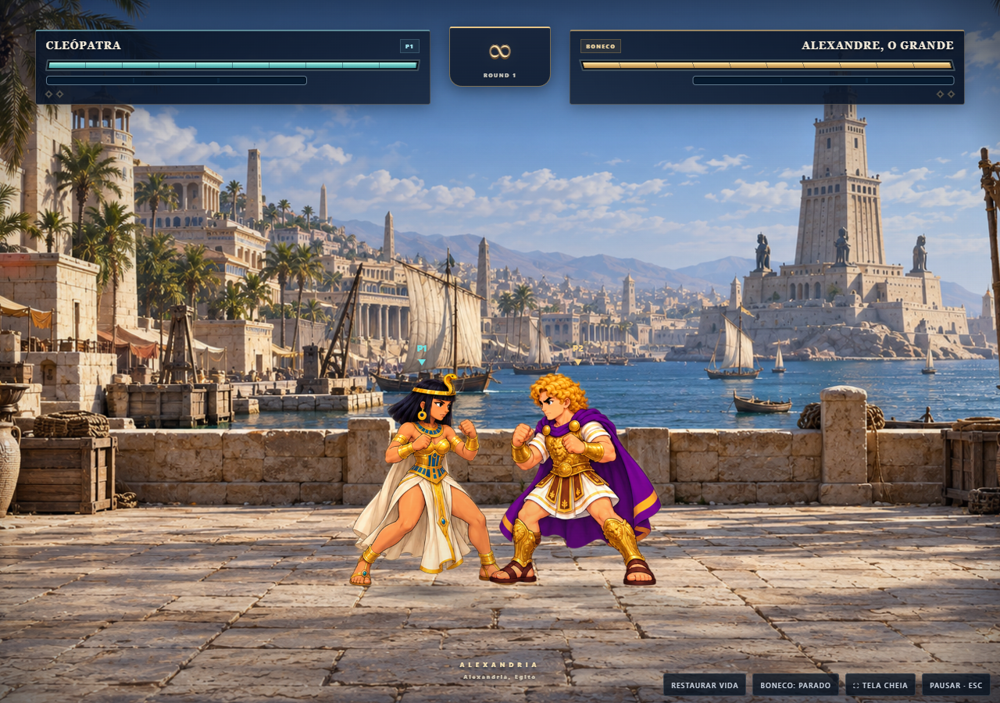

Sou **Felipe Landgraf**, desenvolvedor de software com atuação em aplicações web e jogos. Participo dos projetos **Bandeja** e **Cronos** e sou responsável pelo **desenvolvimento completo do Cronos Fighter**.

Meu portfólio reúne trabalho em equipe e um jogo desenvolvido integralmente por mim, com foco em interação, experiência do usuário e aprendizado.

## Projeto em destaque

### Cronos Fighter

**Desenvolvimento integral · Jogo de luta para navegador**

Personagens históricos se encontram em uma arena que conecta diferentes períodos da História. Sou responsável pelo desenvolvimento completo do jogo, incluindo a lógica de combate, a interface e a integração das animações e dos recursos audiovisuais.

- 24 personagens históricos organizados em seis períodos.
- Combate contra o computador ou entre dois jogadores no mesmo dispositivo.
- Golpes, ataques especiais e animações próprias para cada personagem.
- Suporte a teclado, controles por toque e gamepad.

**Tecnologias:** JavaScript · HTML · CSS · Canvas API · Web Audio API

[Jogar no Cronos](https://joguecronos.com.br/#minigames/cronos-fighters) · [Ver o repositório](https://github.com/Felipe-Landgraf/cronos-fighter)

## Projetos em equipe

### Bandeja
**Desenvolvedor**

Participo do desenvolvimento do Bandeja, plataforma voltada à conexão entre consumidores e vendedores de alimentos. O projeto é construído em equipe como Trabalho de Conclusão de Curso.

### Cronos
**Participante do desenvolvimento**

Integro o projeto Cronos, uma plataforma de aprendizagem de História com trilhas de estudo, atividades e jogos. Minha autoria integral do **Cronos Fighter** é destacada separadamente da participação no projeto principal.

[Conhecer o Cronos](https://joguecronos.com.br)

---

Desenvolvimento do Cronos Fighter por **Felipe Landgraf**. Os recursos de terceiros utilizados no jogo mantêm seus respectivos créditos e licenças no repositório.
